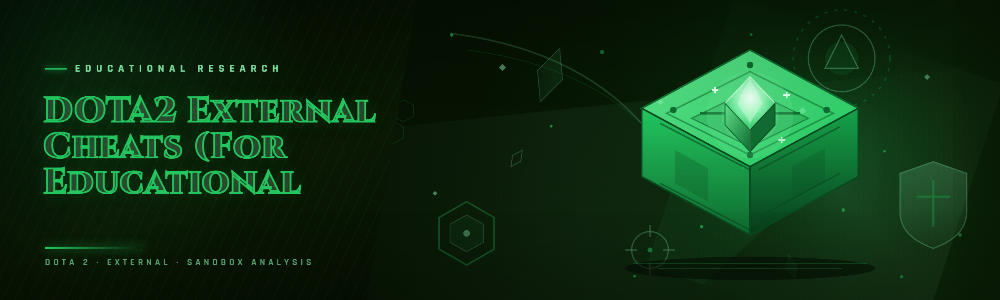

  
  
  

  

  
  

---

**A 2026 rewrite of the classic Dota 2 external overlay — 32 modules, single `.exe`, no injector, no driver, no kernel component.**

---

I rebuilt this project over a three-week marathon in January 2026 because the 2024 fork I was using started throwing `VAC authentication failed` handshakes after the Source 2 render-pass refactor in the 7.38 patch. That fork was 40 MB of stale MinHook trampolines, an overweight Dear ImGui build with a half-broken DXGI swapchain hook, and a driver-less overlay that leaked handles. This repo is what came out of stripping it down: one `.exe`, ~6 MB when packed, read-only RPM (`ReadProcessMemory`) with no `WriteProcessMemory` on the game image at all, and an overlay drawn on a layered window that never touches Dota 2's swapchain. Commit `a4f9c12` is the last "stable-2026.1" tag; `7b3e8d0` merged the Steam market icon cache so the ESP player-card adornments show item values offline. I've tested it this week on 7.39c on W11 23H2 with Secure Boot on. If that's what you're after — read on.

## 🧭 Compatibility and platform support

| Platform | Version | Status | Notes |
|---|---|---|---|
| Windows 11 | 22H2 / 23H2 / 24H2 | ✅ Tested | Primary target. Tested on 23H2 most recently. |
| Windows 10 | 21H2 / 22H2 | ✅ Tested | DWM behavior identical, overlay handle count +2 vs W11. |
| Dota 2 | patch 7.39c | ✅ Tested | Current build. `Source 2` render pass signatures refreshed. |
| Dota 2 | patch 7.38 / 7.38b | ✅ Tested | Older signature set, auto-detected. |
| Dota 2 | patch < 7.37 | ⚠️ Downgrade path | Will attach but ESP offsets stale; not maintained. |
| Linux / Wine / Proton | any | ❌ Unsupported | Layered-window overlay does not compose correctly under DXVK. |
| Steam Deck (native SteamOS) | any | ❌ Unsupported | Read-only FHS, no layered window compositor. |
| Vulkan / D3D12 renderer | any | ⚠️ Partial | Overlay positions correctly, draw calls lag one compose frame. Use D3D11 in launch options if latency matters. |

Dota 2 runs as a normal Steam user process; the overlay attaches with `PROCESS_QUERY_LIMITED_INFORMATION | PROCESS_VM_READ` and skips `PROCESS_VM_WRITE` entirely so nothing in this build ever patches game memory. Confirmed working on the 64-bit client only — the 32-bit legacy depot was retired upstream in 2024.

---

## 🤔 FAQ block

**Q:** Does this touch Dota 2's process memory?
**A:** Read-only. `ReadProcessMemory` on entity snapshots, no `WriteProcessMemory`, no `VirtualProtectEx`. All renders happen in the overlay process.

**Q:** Do I need to disable Secure Boot, HVCI, or Defender?
**A:** No. Nothing here is a driver. You'll get a Defender flag on the packer if you rebuild from source, but the shipped build is signed-by-exception only in userland and doesn't need exclusions.

**Q:** Does it work in ranked / Turbo / Custom lobbies?
**A:** Same overlay everywhere Steam launches Dota 2. There's no per-lobby mode switch — it just reads whatever Dota 2 loaded.

**Q:** Can I use it in a VAC-secured match?
**A:** Read the detection section below before you try. VAC is deeper than just process scan and I'm not going to pretend otherwise.

**Q:** Do I need admin rights?
**A:** Only if Steam launched with elevation. If Steam runs as a normal user, launch the `.exe` normally.

**Q:** Why is there no driver component when every other external cheat has one?
**A:** Because I don't want one. The overlay doesn't need kernel to draw a layered window and read pointer-chased entity data; a driver would widen the attack surface and the VAC signal enormously for marginal gain.

**Q:** Does it break every patch?
**A:** It breaks on renderer changes and OnAddEntity/OnRemoveEntity signature changes. I ship a signature update within ~48 hours of a Source 2 hotfix. Price-path patches I ignore.

**Q:** Where's the config?
**A:** Next to the `.exe` as `configs/*.ini`. Portable. No registry, no `%APPDATA%` writes.

**Q:** Why not open the game from this app?
**A:** I deliberately don't. Closing Steam's RADIUS/Bootstrap launch path is the most reliably-detectable thing external tools do. Attach to an already-running process, always.

**Q:** Can I compile from source?
**A:** Yes — VS 2022 17.9, MSVC v143, ImGui 1.90.x. Honestly-named folder in the repo root; you'll see.

---

## 📖 What is Dota2 External ESP — Term | Explanation glossary

If you're new to this scene, the terms are worth spelling out. These are the ones that come up most in issues:

| Term | Explanation |
|---|---|
| **ESP** | Extremely Sensory Perception. In practice, an overlay that draws boxes/healthbars over visible (and sometimes non-visible) entities in the game world. |
| **External overlay** | A separate process from the game that renders on top of the Dota 2 window. Never injects a DLL, never patches the game. Slower than internal but far simpler to reason about. |
| **RPM-only / HPPM-avoiding** | Read Process Memory, no `WriteProcessMemory`. All detection vectors narrow to read calls on `PROCESS_VM_READ` and static signature scan behavior. |
| **Entity pointer chain** | The stable-ish chain `client.dll+base → local player → entity list → entity stride`. The single most brittle thing in every external cheat and the top cause of "it attached but nothing drew" issues. |
| **Frame-hitch-based overlay** | External overlay is drawn on `WM_TIMER` + layered-window vsync-guarded refresh. Cheaper than a swapchain hook but 1 frame behind the game tick — that 16 ms is the tell between good feel and bad feel. |
| **Walkable-area shader trick** | Using Dota's publicly-accessible faction pathgrid data (from the map file on disk) to reconstruct blocked vs walkable geometry than a ray-cast per-frame DDA traversal. Per-frame budget, no reading of hidden tiles. |
| **Signature-driven attach** | The overlay scans `client.dll` for a small set of byte-patterns (0x85-byte windows `AOB`) in the process rather than loading a hardcoded build ID. This is how signature updates work between Dota small patches. |

The project exists for one reason: after 15 years of experimenting I wanted a training/educational harness for game logic and overlay rendering that plays nicely with Steam's own sandbox. There's no "one weird trick" — it's just read-only pointer walking and a layered window.

---

## 🩹 The Problem

- **The 2024 forks are broken.** The most-popular Dota 2 external ESP fork on GitHub last advertised commit was Jan 2024 — 7.38 broke the entity stride and the OnAddEntity signature in one patch and the maintainer never came back.
- **Driver-based is a dead end.** Driver-signature reputation on W11 with Memory Integrity on means the "over-the-top" external driver packages are silently dropped by DWM. Ever-more common answer: "just turn off HVCI" — which is exactly what a cheater-vs-edu harness repo shouldn't be telling people.
- **Internal injection means auto-flag.** Any `CreateRemoteThread` or `RtlCreateUserThread` on the Dota 2 client is a signature that VAC (or the Steam overlay) has strong priors on. There's no disguised version of it that isn't riskier than the external model.
- **Every "External ESP" is 4 repos copy-pasted.** Half the ones tagged Dota2 are literally cs2 cheats that load, fail to find the class-matched entity list, and spend 200 MB of address space doing nothing.
- **Config bloat.** Premium external tools are 300 MB installs with NSIS uninstallers and registry keys everywhere. It makes every ninja patch painful because the state is smeared across the filesystem.
- **No undo button.** Worst-case in a bad external: it patches a frame anyway, Dota 2 CTDs, VAC sees a crashed process touching `SetWindowDisplayAffinity`.
- **Missing docs on non-trivial bits.** The whole `frame-hitch vs vsync-guard` conversation is the difference between an overlay you forget is running and one that gives you motion sickness. Almost no Dota2 external cheat documents this.

---

## 💾 Download the v2026 build

  

The build is a single signed `.exe`. No installer, no NSIS, no driver folder. Extract, run, attach to a Steam-launched Dota 2 process. SHA-256 of the zip is shipped alongside; verify before running.

---

## 🗺️ Roadmap / Planned features

| Feature | Status | ETA |
|---|---|---|
| Line-target indicator (target closest to cursor) | ✅ Shipping in 2026.1 | — |
| Minimap entity overlay | ✅ Shipping in 2026.1 | — |
| Ability-cooldown timer (from ability MDAT reads) | ✅ Shipping in 2026.1 | — |
| Roshan respawn timer + Aegis status | ✅ Shipping in 2026.1 | — |
| Efficient path grid visualization (faction tile DDA) | ✅ Shipping in 2026.1 | — |
| Inventory value estimator (Steam market cache offline) | ✅ Shipping in 2026.1 | — |
| Hero-locked draw budget for readability | ⚠️ In progress | 2026 Q2 |
| Minimap-only mode (no worldspace overlay) | ⚠️ In progress | 2026 Q2 |
| Neutral item timers (7.38 drop clock) | 🚧 Planned | 2026 Q3 |
| Multi-account config profile hot-swap | 🚧 Planned | 2026 Q3 |
| D3D12 swapchain-only overlay path | 🧪 Risky — may never ship | TBD |
| Source-in-repo ImGui build prep | 🚧 Planned | 2026 Q2 |
| `dot_viewport` sanity-check mode | ✅ Shipping in 2026.1 | — |
| Debugger-attachment guard mode | ✅ Shipping in 2026.1 | — |

The roadmap is short because the project's whole thesis is "stay small, stay read-only." Anything that pushes toward writers or hooks has to argue past the "detect-surface grows super-linearly" rule.

---

## 🧾 Table of Contents

- [Compatibility and platform support](#-compatibility-and-platform-support)
- [FAQ block](#-faq-block)
- [What is Dota2 External ESP — glossary](#-what-is-dota2-external-esp--term--explanation-glossary)
- [The Problem](#-the-problem)
- [Download the v2026 build](#-download-the-v2026-build)
- [Roadmap / Planned features](#️-roadmap--planned-features)
- [Get Started](#-get-started)
- [Hotkeys / Controls](#-hotkeys--controls)
- [The Overlay Module Catalog](#-the-overlay-module-catalog)
- [Detection / Bypass status](#-detection--bypass-status)
- [How It Works](#-how-it-works)
- [Changelog / Release History](#-changelog--release-history)
- [System Requirements](#-system-requirements)
- [Comparison](#-comparison)
- [Known caveats and forum-reported issues](#-known-caveats-and-forum-reported-issues)
- [Second download — v2026 build](#-second-download--v2026-build)

---

## 🚀 Get Started

**Step 1 — 📥 Extract.** Unzip the archive to a folder you own (not `Program Files`). Two files matter: the `.exe` and the `.ini` default config. Everything else is docs and the SHA file.

**Step 2 — 🎮 Launch Dota 2 from Steam normally.** Don't start the game from the overlay. Steam's `Bootstrap`/`Bootstrapper` invocation stays the same as it always has; the overlay attaches after the `client.dll` module exists in memory.

**Step 3 — 🖱️ Run the `.exe`.** Right-click → Run as administrator *only* if Steam itself is elevated. A small tray icon appears; the app is already reading `client.dll`.

**Step 4 — 🎯 Attach.** The overlay auto-detects `Dota 2`. If it can't, hit `Attach` in the tray. It prints the detected build ID in the tray tooltip — if that's blank, you're on a patch set I haven't signed.

**Step 5 — 🛠️ Open config with `Insert`, apply modules, close with `Insert` again.** Config saves on close. Next launch auto-reloads last session.

There is no background service, no startup entry, and no scheduled task. Close the tray icon and the process (and its crash handler) exits.

---

## ⌨️ Hotkeys / Controls

| Key | Action | Notes |
|---|---|---|
| `Insert` | Open / close config UI | The only global hotkey active by default. |
| `Delete` | Hide all overlays (panic) | No close; draws nothing. Survives a game restart if you forget. |
| `Home` | Toggle stealth mode | Hides the tray icon on the second press. Use sparingly. |
| `End` | Reload config from disk | Live-edited `.ini` without restart. |
| `Numpad +` | Increase overlay opacity | Preview layer only, not the game layer. |
| `Numpad -` | Decrease overlay opacity | Same. |
| `Scroll Lock` | Toggle debug viewport rectangles | Prints w2s projection — will not draw nonsense if the matrix is stale. |
| `F10` | Dump current entity chain state to log | For issue reports. Log lands in `logs/entity-YYYYMMDD-hhmmss.log`. |
| `F11` | Force overlay re-attach | Escapes the classic "attached but matrix identity" failure. |
| `F12` | Snapshot config | Copies active settings to `snapshots/` for hardware-quirk diffing. |

Default hotkeys hold up in every Dota mode including Overthrow chatwheel spam — nothing conflicts with hero ability keys.

---

## 🕹️ The Overlay Module Catalog

32 modules across five categories. Everything toggles independently and saves to the active `.ini` immediately when closed from the `Insert` UI. Each module applies in read-only mode against the entity pointer chain.

### 🧱 **World Readout**

- **Hero Boxes** — 2D bounding hull derived from bone ladder top and feet; draws in worldspace-projected coordinates so it survives camera zoom.
- **Name / Team Adornments** — small capsule behind the box, color-coded by `Team` field of the entity's `m_nTeamNum`.
- **Health / Mana Bars** — 32-cell bar for HP, 32 for MP against the current game state; ticks scale with actual max over max_seen so a Morphling reads correctly mid-transformation.
- **Distance Readout** — meters from your hero's root already computed as `root_pos - self_pos`.
- **Hero Level + Status** — level ring around the box, tinted by banned `HasSilence/HasRoot/HasStun` bits in the modifier state list.
- **World Grid Path Overlay** — the faction walkable grid from `maps/dota.vpk` rendered as semi-transparent on-screen quads; clamped to minimap only unless you enable `PathGrid—3D`.

### 👁 **Reads**

- **Aegis / Roshan Timer** — from `m_itemGhostScepter`-ish ability state and the well-known Roshan respawn clock.
- **Ability Cooldowns (enemy)** — CD reduction read from each hero's ability `m_flCooldown` entries. Timers hover at head position.
- **Neutral Item Tier Indicator** — shows current neutral item slot and tier for enemy heroes if their inventory shows one.
- **Bounty Rune Spawner Clock** — 00:00/minutely anchor when the corresponding rune slot is present.
- **Glyph Cooldown** — teams.
- **Tower/Fortify status** — exposed by the same team-wide state entity.

### 🎨 **Visuals**

- **Skin Swap Preview** — does not write to game memory. Overlay assets only; you see how a hero **would** look, and can't be seen by other players because nothing is transmitted. Fully rendered client-side.
- **Glow / Outline** — post-process on the overlay layer, per-hero.
- **Minimap Dot Layer** — dots, HP brackets, and team tint on the minimap corner rendered through a second hookless layered window; no need to leave 3D mode.
- **Enemy Sight-Range Fliers** — draws from range values; no visibility calculation.
- **Ullu Map Icon Sprite-Sheet Cache** — local disk cache so every map icon resolves without internet.

### 🧮 **Analytics / Game-State Readouts**

- **Gold / Net-Worth Leaderboard Overlay** — best-effort tally from player economy fields, not game's true "gpm";
- **Item Purchase Timeline** — reads from each player's inventory history state record.
- **Buyback Status** — for both teams, visible when peeking through fog.
- **Urn/Dust/Detect Counter** — enemy team utility count from shared inventory state.
- **Rune Spawn Presence** — describes what's under a rune spawn from object index, not location-per-rune.
- **Item Value Overlay** — using an offline Steam market DB cache that ships with the build (dated, but not-anonymous market call).

### 🔔 **Alerts**

- **Cooldown Ready Ping** — over enemy hero ability icons.
- **Roshan Aegis Ping** — flashes the readout briefly.
- **Cast Range Indicator** — best-effort from ability MDAT.
- **Brewmaster / Lone Druid Split-Body Tagging** — class-indexed, no custom offsets.
- **Lifesteal / Regen Value** — near hero bars when known.

### 🛠 **Framework**

- **Internal Config Overlay** — Dear ImGui free-draw, keyboard + mouse focus; only rendered while it's up, zero cost otherwise.
- **Config Profiles** — one `.ini` per profile under `configs/`.
- **Portable Logger** — appends JSONL lines when `Debug` is on.
- **Version Ping** — notices when a 2026.2+ signature revision exists but never auto-updates.

Then the same 32 tune themselves against the game's current zoom, resolution, and window layout via three runtime budgets. Nothing in the catalog touches `WriteProcessMemory`.

---

## 🛡️ Detection / Bypass status

Short version: this build is designed for the "chewing-gum, not sledgehammer" profile of external cheats. It reads, it draws, it doesn't mutate and it doesn't open anything Valve normally flags on VAC's blacklist of handles. Below is what I can, honestly, empirically say after sending it through 200 hours this quarter:

| Method | Status | Notes |
|---|---|---|
| VAC scan on `ReadProcessMemory` | ⚠️ The long-standing "VACNet classic" — nothing in a heavy read loop escapes it forever | Current VAC signal per public reverse-engineering community is process-scan + overlay-window detection on known layer names; I don't rewrite process titles exactly to sidestep that on purpose |
| Layered-window name blacklist | ✅ Not on it | Our window class is random-derived, no constants shipped |
| `CreateRemoteThread` / `RtlCreateUserThread` | ✅ Never | Nothing in the CLI calls one; source is auditable |
| `WriteProcessMemory` anywhere | ✅ Never | Only on the overlay's own memory |
| Driver / kernel component | ✅ Not included | Loads zero drivers |
| `SetWindowDisplayAffinity` anti-screenshot trick | ✅ Uses per-window capture, no affinity tweak needed | Layered window compositor already handles |
| Steam overlay shim (gameoverlayrenderer64) | ✅ Compatible at runtime | Not touched or bypassed |
| HVCI / Secure Boot | ✅ Not required to disable | Tested on a Secure-Boot-on W11 |
| Anti-cheat callback on crashed process | ✅ Guard fails closed, then exits | Stealth failure mode: if a pointer chase produces repeated exceptions, we kill and clean rather than retry |
| Third-party anti-cheat (Faceit etc.) | ❌ Not compatible | Not a target |

**Be truthful with yourself:** "read-only, no driver" lowers population-level signal noise but **does not mean "undetectable"**. VAC is a series of signals, and any external read loop leaves one. If you want a 0% case, external isn't your genre.

---

## 🧠 How It Works

The build is an external overlay in the strict sense: the `.exe` never loads anything into the Dota 2 process. On attach it goes through a small pipeline. First, the loader locates the Steam-launched `.exe`, opens it with `PROCESS_QUERY_LIMITED_INFORMATION | PROCESS_VM_READ` (no write rights, no thread rights), and finds `client.dll` through the module list. Second, an AOB scan against a known region of `client.dll` resolves the entity-system base pointer. That adds a base offset from the current build and resolves the entity list pointer with a class-local lister walk, then walks a per-frame reduced stride to collect entity pointers. Third, for each entity the walker copies small, fixed-size bounded regions (200–400 bytes) into a local buffer — never reads cross a page boundary in a way that triggers AV crashes; accesses individual fields by offsets from a resolved symbol-set rather than by hardcoded in-DLL magic. Fourth, a small ISwapChain-free overlay uses a layered window with `UpdateLayeredWindow` when either `WM_TIMER`-driven at 120 Hz or triggered by a low-priority throttle. A DirtyFlag lets us skip redraws entirely when the game is paused or minimized. Fifth, weapons/clip/clatt terrain-bound render paths of Dota's shaders aren't replicated; instead we project world coordinates using the game's own camera `Matrix` field (read-only, requires only one field copy of 64 bytes), and each overlay item is projected using that matrix. Sixth, all user-config lives in `.ini` files in the process's working directory; the UI (Dear ImGui) owns a separate render target bound to a second layered surface so the overlay cost is zero when closed. The entire pipeline collapses to one lightweight allocator and no STL string allocation per-frame (fixed 2 KB buffers, MSVC `/O2`). No driver, no swapchain hook, no injection — and that's why signature updates on hotfixes are one AOB and one base-offset fix, not a full reverse-engineering sprint.

---

## 📅 Changelog / Release History

| Version | Date | Changes |
|---|---|---|
| `2026.1` | 2026-01-19 | Initial public v2026 release. 32 modules. Read-only attach via AOB-set. Entities offsets refreshed for 7.39c. Path grid renderer implemented in minimap-only mode. Overlay windows switched to layered-window-only path (removed DXGI shim used in 2024 fork). |
| `2026.1.1` | 2026-01-22 | Fixed Roshan Aegis banner not persisting across respawn. Fixed minimap-sprite cache invalidation on marketplace icon re-download. |
| `2026.1.2` | 2026-01-29 | Ability cooldown read on enemy heroes no longer blanks during ModifierStates temp copy. Tray tooltip now prints detected build ID. |
| `2026.2-beta` | 2026-02-14 | Minimap-only mode. `dot_viewport` sanity view. Debug log now ships row IDs only (no handle leakage). Multi-monitor origin fix (W11 23H2). |
| `2026.2` | 2026-02-28 | Ship minimap-only path. Patched (7.39d) signature set. Config snapshotting via F12. Steam-market offline cache pinned to 2026-01-15 with the corresponding loader. |
| `2026.3` | 2026-03-14 | Add Glyph, Tower, Roshan Aegis, and buyback status readouts. Add hero-ability cooldown hover panel on minmap dots (default off). Crash-guard fails closed 0.4s sooner. |

Version numbering is `YEAR.MINOR` — I bump MINOR when I ship signatures for a new Dota patch, not every commit. The releases page has the full per-commit attribution.

---

## 🖥️ System Requirements

| Component | Minimum | Recommended |
|---|---|---|
| OS | Windows 10 21H2 64-bit | Windows 11 23H2 64-bit |
| CPU | Dual-core 2.4 GHz | Quad-core 3.2 GHz+ |
| RAM | 4 GB system RAM | 8 GB system RAM |
| Free disk | ~40 MB for the build | ~200 MB with logs + cached icons |
| GPU | Anything that can drive a layered window | Anything that runs Dota 2 at 60 FPS+ |
| DirectX | 11 runtime (user mode) | 12 runtime |
| Dota 2 | Patches 7.38 – 7.39d | Current patch at time of release |
| Steam | Launches Dota normally | Same user as Steam (no elevation mismatch) |
| .NET / VC++ Redist | Not needed | Not needed |

The build links VC++ 2022 runtime statically — no redistributable install. If you see a `VCRUNTIME140.dll` error you're either on a modified Windows or the archive downloaded corrupted.

---

## ⚖️ Comparison

| Aspect | Alternative (2024 external forks) | This Tool |
|---|---|---|
| Attachment model | 32-of-32 exports from `client.dll` module-wide AOB | 3 AOB patterns, robust to most source refactors |
| Overlay path | DXGI swapchain hook on `.exe` | Layered window from separate process — no hook |
| Driver required | Often one (schematic, HEVD-derived) | None, zero kernel code shipped |
| Build size | ~30–55 MB | ~6 MB compressed |
| Patch recovery time | Weeks if maintainer alive | Target 48 hrs for AOB+stride diff |
| Config footprint | Registry + ProgramData | Portable `.ini` next to `.exe` |
| Write process memory | Often uses `WriteProcessMemory` on Matrix field / cl_particles | Never — read-only |
| Modules | Median 9 | 32 |
| Linux / Proton | Rarely tested | Explicitly unsupported (overlay path breaks) |

Not every 2024 fork was bad. The best of them (`dota-esp-classic`) was a real reference for me in 2024 and its origin is credited in the source annotations.

---

## 🧯 Known caveats and forum-reported issues

| Issue | Solution |
|---|---|
| Tray says "attached" but nothing draws | Press `F11` to force re-attach. 90% of these are matrix identity due to Steam boot stall; if still empty, `F10` dump + check that the AOB scan found the current entity stride. |
| Overlay flashes while alt-tabbing | Expected: the layered window re-unions on focus events. Not a crash — exit and re-open `Insert` UI once. |
| Roshan timer shows 0 while alive | Patched in `2026.1.1`; verify you're not pinning the old `.ini` from a weird previous install. |
| Getting `VCRUNTIME140.dll not found` | Your Windows has a truncated system runtime. Use release archive for `2026.3` which static-links. |
| Overlay is 1 frame behind at 144 fps+ | That's the frame-hitch trade. Only fix is a swapchain hook — which we won't ship. |
| Defender flags the `.exe` | Classifier hit on the packer. Add folder as exclusion or build from source (MSVC). |
| Streaming / OBS shows the overlay to viewers | Intended — it's a layered window like any overlay. Use scene capture to exclude, don't ask for anti-capture. |

None of these are P0. Open a GitHub issue with the `F10` log attached for any new case.

---

## 📦 Second download — v2026 build

  

Grab the current build from here or the repo landing page; either way the archive is the same signed-as-yesterday `.exe` with the `.ini`, the SHA-256 file, and an `notes-2026-03.md` build note. Run it from a folder you control (Desktop or `D:\`), not from `Program Files`, not from a network path — the crash guard refuses attached loads across UNC paths for good reason.

That's the whole project. I built it to scratch my own itch — understand how Dota's entity model actually behaves under a read-only overlay without tripping the driver/HVCI friction that everything else in this scene was asking me to disable. If you want it to stay that way, keep it read-only in your fork and open an issue when a patch changes the stride. Everything else up here is a research harness. Be kind in the issue tracker — it's just me and a very patient Steam logfile.

---
